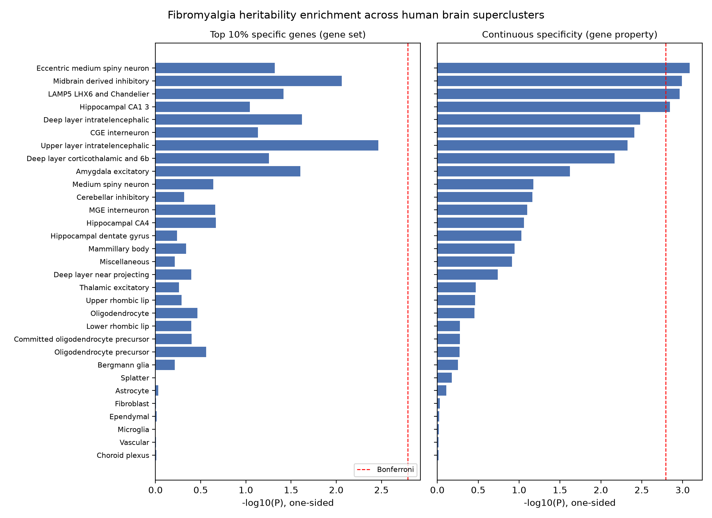
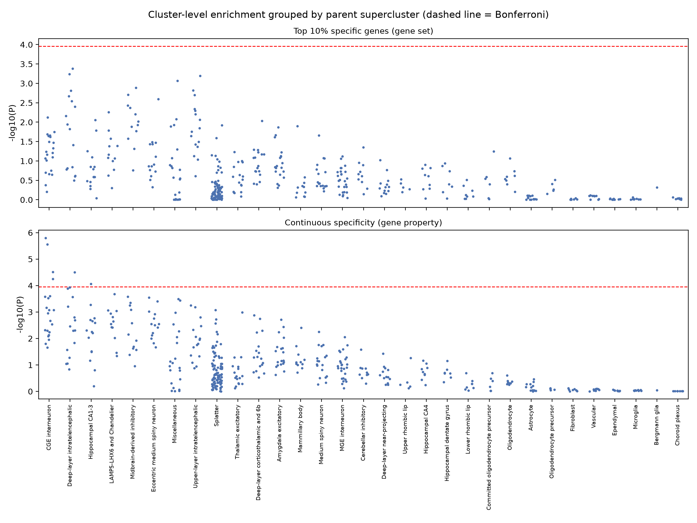

------------------------------------------------------------------------

editor_options: markdown: wrap: 72 ---

# Mapping fibromyalgia genetic risk onto human brain cell types

An exploratory, reproducible analysis asking which human brain cell types carry fibromyalgia heritability, using public GWAS summary statistics and a 3.4-million-nucleus human brain atlas.

> This is a personal portfolio project. Not peer reviewed.

## Background and question

A 2026 *Nature Medicine* GWAS meta-analysis (Kerrebijn et al.) concluded that fibromyalgia heritability is enriched in neurons and not in immune cells or glia, with dentate gyrus neurons the strongest cell type. That enrichment used a mouse single-cell atlas. The authors note that closely related neuronal types share marker genes which limits how precisely a cell type can be named.

This project repeats the cell-type analysis with a human single-nucleus atlas and asks:

1.  Is the neuronal-not-glial pattern reproduced in human cells?
2.  Does the dentate gyrus stand out?
3.  Is the signal specific to particular neuronal types, or is it generic neuronal expression?

## Data

| Resource | Details |
|-------------|-------------------------------------------------------|
| Fibromyalgia GWAS | GWAS Catalog GCST90838603: European-only meta-analysis, 2,313,287 individuals, 12.1M variants, GRCh38 (CC0) |
| Brain atlas | Siletti et al. 2023 human whole-brain snRNA-seq via the Allen Brain Cell Atlas: 3,369,219 nuclei, 31 superclusters, 461 clusters, 3,313 subclusters (CC BY-NC 4.0) |
| LD reference | 1000 Genomes Phase 3 European panel, GRCh38 (633 samples), plus Ensembl release 115 gene locations, from the GNExT reference data (Zenodo 10.5281/zenodo.17940903) |
| Software | MAGMA v1.10 (de Leeuw et al. 2015), Python (pandas, scanpy/anndata, scipy, statsmodels) |

## Method in brief

1.  **GWAS QC.** Removed 34,038 placeholder rows; checked inflation and effect directions; reproduced 17 independent genome wide significant loci covering every region the paper labels.
2.  **Matching to the reference.** Filtered to variants with effective sample size at least 0.67 of the 90th percentile (9.57M of 12.1M variants remained), then matched to the GRCh38 reference by chromosome, position and allele pair: 97.2% matched, including the HTT lead indel.
3.  **Gene-level association.** MAGMA SNP-wise mean model, 35 kb upstream / 10 kb downstream window, 19,819 genes.
4.  **Cell-type specificity.** Raw counts aggregated into pseudobulk profiles per subcluster, rolled up to clusters and superclusters; specificity = a gene's share of its total CPM across cell types.
5.  **Enrichment.** Two MAGMA tests, both one-sided: (a) the top 10% most specific genes per cell type as a gene set, and (b) continuous specificity as a gene property. Cell types with fewer than 100 cells excluded; Bonferroni correction within each level (31 superclusters, 453 clusters).

## Results

**Sanity checks passed.** MAGMA's top genes include *MAML3*, *DCC*, *CAMKV* and *MST1R*, all at loci the paper reports; the HTT lead variant is in the analysis (gene-level P = 6.7e-8).

**Cell-type enrichment (continuous specificity method)**

| Level | Bonferroni-significant | Notes |
|---------------|--------------------------------|------------------------|
| Superclusters (31 tests) | Eccentric medium spiny neuron (P = 8.2e-4), midbrain-derived inhibitory (1.0e-3), LAMP5-LHX6 and Chandelier (1.1e-3), hippocampal CA1-3 (1.4e-3) | All neuronal |
| Clusters (453 tests) | Six clusters: four CGE interneuron clusters (P = 1.6e-6 to 5.6e-5) and two small clusters (152 and 492 cells) from amygdala and olfactory dissections | The two small clusters come mostly from a single donor and brain region and are excluded from conclusions |

 

- No glial, vascular or immune cell type shows enrichment at default settings (all P \> 0.2 by both methods).
- The dentate gyrus does not stand out (P = 0.58 by gene sets, 0.093 by continuous specificity).
- The top-10% gene-set method gives no Bonferroni-significant result at any level. Its results are consistent in direction but weaker.

### Robustness checks

| Check | Outcome |
|-----------------------|------------------------------------------------|
| Remove the strongest locus (61 genes at chr3:49-51 Mb) | Same cell types significant |
| Restrict to donor-balanced cell types (top donor share at most 0.5, 0.6, 0.8) | Four CGE interneuron clusters significant at every threshold; other significant clusters vary with the threshold |
| Vary the gene-set fraction (5%, 10%, 20%) | Which neuron type ranks first changes with the fraction; deep-layer intratelencephalic and LAMP5-LHX6/Chandelier neurons stay in the top six every time; at 20%, midbrain-derived inhibitory (supercluster) and a donor-balanced deep-layer intratelencephalic cluster pass Bonferroni (a second, donor-dominated cluster also passes) |
| Condition on pan-neuronal expression | No supercluster passes, but the same neuronal types still lead; three CGE interneuron clusters (279, 289, 288) remain significant (P = 4.6e-6, 8.2e-6, 8.7e-5) |

### Conclusions

- **Supported:** fibromyalgia heritability is enriched in neuronal cell types and not glia, consistent with the published GWAS.
- **Moderately supported:** specific CGE interneuron subtypes carry signal beyond generic neuronal expression.
- **Not supported here:** the dentate gyrus as the leading cell type, and any single named supercluster as "the" cell type.

## Limitations

- The atlas has effectively three donors (a fourth contributes 2% of nuclei), and sampling is confounded with brain region.
- The atlas is brain only. It has no enteric or peripheral sensory neurons, so the paper's second-strongest signal (enteric neurons) cannot be tested.
- European-only GWAS; case status is defined by ICD code.
- Only the continuous-specificity method reaches Bonferroni significance, and the gene-set method is sensitive to the top-gene fraction.
- Several choices were made after viewing results (the donor-balance threshold; reading the top-fraction checks). These are labelled as post-hoc robustness checks in the scripts and are not confirmatory tests.
- The reference panel includes 633 samples, probably including related individuals, which can slightly distort LD estimates.
- Results from MAGMA and LDSC-SEG (the paper's method) are not directly comparable.

## Reproducing

Software setup: `conda env create -f environment.yml`. MAGMA's license forbids redistributing its binary, so download v1.10 from the MAGMA site into `tools/magma/`. Raw data and large intermediates are not tracked.

| Script | Purpose |
|---------------------------------|------------------------------------|
| `00_inspect_h5ad.py` | Inspect atlas matrices without loading them |
| `01_gwas_qc.py`, `02_gwas_loci.py` | GWAS quality control and locus table |
| `03_taxonomy_map.py` | Subcluster to cluster to supercluster lookup |
| `04_pseudobulk.py` | Aggregate counts per subcluster |
| `05_prepare_magma_input.py`, `05b_check_lead_variants.py` | Match GWAS to the reference; verify lead variants survive |
| `06_specificity.py`, `06b_marker_check.py` | Cell-type specificity; marker gene sanity check |
| `07_make_magma_celltype_inputs.py` | MAGMA gene property and gene set inputs |
| `08_summarise_enrichment.py` | Annotate results, multiple testing correction, figures |
| `09_characterise_clusters.py`, `10_donor_balance.py` | Marker genes and donor composition; donor balanced analysis |
| `11_add_pan_neuronal_covariate.py`, `12_summarise_conditional.py` | Conditional analysis on pan-neuronal expression |

MAGMA commands (annotation, chromosome-batched gene analysis, enrichment) were run from the shell as described in the MAGMA v1.10 manual; the window and model settings are given above.

## References

- Kerrebijn I, et al. The genetic architecture of fibromyalgia across 2.5 million individuals. *Nat Med* 32, 3060-3070 (2026).
- Siletti K, et al. Transcriptomic diversity of cell types across the adult human brain. 2023.
- de Leeuw C, et al. MAGMA: generalized gene-set analysis of GWAS data. *PLoS Comput Biol* 11(4): e1004219 (2015).
